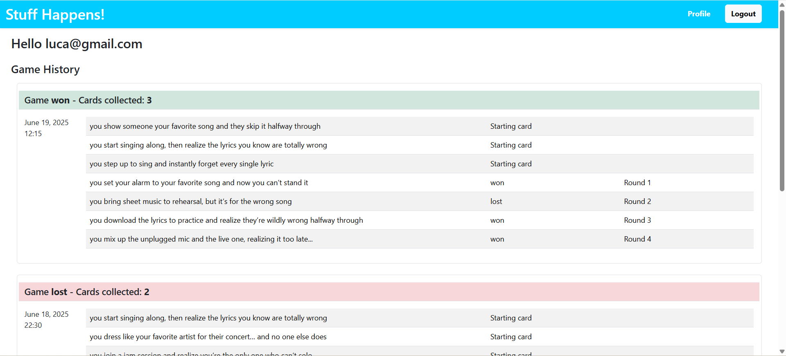
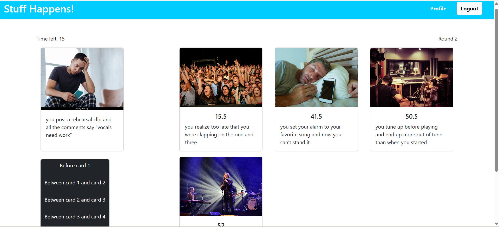

[](https://classroom.github.com/a/ArqHNgsV)

# Exam #1: "Stuff Happens"

## Student: s340336 MAGENTA ALICE PAOLA

## React Client Application Routes

- Route `/`: shows game rules, lets users start a new game. Non-logged users see the same page as logged users, plus a banner that suggests to log in
- Route `/game/:gameId`: contains the actual game - it shows cards, buttons and all other elements for the game logic. It is used both by logged and guest users, only the implementation of the game will change. The parameter :gameId is the database identifier of the current game.
- Route `/login`: contains the form to perform the login. Only guest users can access to this page.
- Route `/user/profile`: shows the email of the user and his/her game history, in tables sorted by date. Tables show the outcome of games and their rounds, the number of cards collected per game and the cards' names. This page can only be accessed by logged users.

## API Server

- GET `/api/cards`
  - get initial three cards for a game
  - no request parameters
  - response body content:
  ```
  [
    { "id": 1, "name": "you step up to sing and instantly forget every single lyric", "image": "images.jpg", "index": 73.5 },
    { "id": 2, "name": "auto-tune glitches and now you sound like a dying dolphin", "image": "images.jpg", "index": 81 },
    { "id": 3, "name": "you accidentally drop the bass... and the usb stick", "image": "Inter-DJ.jpg", "index": 53 }
    ]
  ```
  GET `/api/card`
  - get card for a round (without index)
  - no request parameters
  - response body content:
  ```
  [
    { "id": 1, "name": "you step up to sing and instantly forget every single lyric", "image": "images.jpg"},
    ]
  ```
  GET `/api/card/<cardId>/index`
  - get the index of a card
  - request parameters: cardId, the identifier of the corresponding card
  - response body content:
  ```
  [
    { "index": 53}
    ]
  ```
- POST `/api/<userId>/cards`
  - save the game started by the player (no outcome yet)
  - request parameters: userId, the identifier of the current user
  - request body content:
  ```
  [
    { "outcome" : "in progress", "card1": 2, "card2": 16, "card3": 4, "gameDate": "2025-06-18T19:50:16+02:00" },
    ]
  ```
  - response body content:
  ```
  [
    { "gameId" : 22 }
    ]
  ```
- POST `/api/game/<gameId>/round`
  - save the round played in a the current game
  - request parameters: gameId, the identifier of the current game
  - request body content:
  ```
  [
    { "outcome" : "lost", "roundNumber": 2, "cardId": 16 }
    ]
  ```
  - response body content: none
- PUT `/api/game/<gameId>/`
  - save the result at game over
  - request parameters: gameId, the identifier of the current game
  - request body content:
  ```
  [
    { "outcome" : "won" }
    ]
  ```
  - response body content: none
- GET `/api/user/<userId>/profile`
  - get game history to visualize it in user's profile
  - request parameters: userId, the identifier of the current user
  - response body content:
  ```
  [
    { "id": 10, "outcome": "won", "gameDate": "2025-06-18T19:50:16+02:00", "card1": "you step up to sing and instantly forget every single lyric", "card2": "auto-tune glitches and now you sound like a dying dolphin", "card3": "you accidentally drop the bass... and the usb stick", "rounds":
    [
      {"id": 29, "outcome": "won", "roundNumber": 1, "cardName": "you try to hit a high note and your voice flips into cartoon falsetto"},
      {"id": 30, "outcome": "won", "roundNumber": 2, "cardName": "you show someone your favorite song and they skip it halfway through"},
      {"id": 31, "outcome": "won", "roundNumber": 3, "cardName": "you spend all night learning a riff and someone says “oh yeah, that meme song""}
    ]},
    {...}
    ]
  ```

## Database Tables

- Table `card`
  - Columns:
    - id: unique identifier for a card
    - name: name of the card
    - image: image taken from the `public` directory
    - index: unique index of a card
- Table `game`
  - Columns:
    - id: unique identifier for a game
    - outcome: string to save the result ("won"/"lost"/"in progress")
    - userId: id of the user that played the game, references "id" of `user` table
    - card1: id of first card of the game, references "id" of `card` table
      table
    - card2: id of second card of the game, references "id" of `card` table
      table
    - card3: id of third card of the game, references "id" of `card` table
    - gameDate: current date at start of the game
- Table `round`
  - Columns:
    - id: unique identifier for a round
    - outcome: string to save the result ("won"/"lost")
    - roundNumber: number of this round inside a game
    - cardId: id of the card of this round, references "id" of `card` table
      table
    - gameId: id of the game of this round, references "id" of `game` table
      table
- Table `user`
  - Columns:
    - id: unique identifier for a user
    - email: unique email of the user
    - password: hashed password of user
    - salt: corresponding salt of password

## Main React Components

- `DefaultLayout` (in `DefaultLayout.jsx`): defines the layout for all pages of the app. Contains the navigation header (defined in another component), defines the structure for the welcome message after login and for the banner that suggests login to guest users.
- `Game` (in `Game.jsx`): main component of the application. Implements the logic to start a game, going through rounds and managing of game over and restart. It manages the timer for rounds, shows cards, saves round and game info in case the user is logged. It includes the cards for the game, buttons for starting rounds and games, and buttons to place cards in the player's collection. Shows also timer, round number and number of cards collected to user.
- `HomeGame` (in `HomeGame.jsx`): defines the homepage of the application. Contains game rules and a button to start the game, that links to `Game`.
- `UserProfile` (in `UserProfile.jsx`): fetches and shows the game history of the user. Game history is shown as tables ordered by decreasing date, with info about game outcome, rounds outcomes, and collected cards divided by round.

(only _main_ components, minor ones may be skipped)

## Screenshot





## Users Credentials

- email: luca@gmail.com, password: ciao123 (played some games)
- email: irene@gmail.com, password: 123456 (never played)
